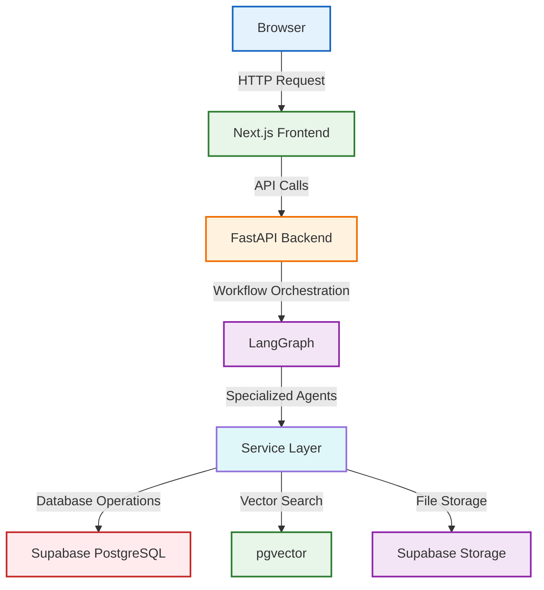

# CareerTwin


CareerTwin is an AI-powered career intelligence system for students. It maintains an evolving structured representation of a student's professional state called the **CareerTwin**.

<div align="center">
  <a href="https://img.shields.io/github/stars/Hari-preetham-B/Agentic-Ai?style=social" target="_blank">
    
  </a>
  <a href="https://img.shields.io/github/forks/Hari-preetham-B/Agentic-Ai?style=social" target="_blank">
    
  </a>
</div>

## 🏗️ Architecture Overview

```mermaid
graph LR
    A[Resume Upload] --> B[Text Extraction]
    B --> C[Data Parsing]
    C --> D[Profile Creation]
    D --> E[Confirmation Workflow]
    E --> F[CareerTwin State]

    style A fill:#fffde7,stroke:#f57f17,stroke-width:2px
    style B fill:#e8f5e9,stroke:#2e7d32,stroke-width:2px
    style C fill:#e8f5e9,stroke:#2e7d32,stroke-width:2px
    style D fill:#e8f5e9,stroke:#2e7d32,stroke-width:2px
    style E fill:#e8f5e9,stroke:#2e7d32,stroke-width:2px
    style F fill:#e8f5e9,stroke:#2e7d32,stroke-width:2px
```





## ✨ Features

| Feature | Status |
| ------- | ------ |
| Repository structure | ✅ |
| Frontend shell (Next.js + Tailwind + Motion) | ✅ |
| Backend shell (FastAPI + Pydantic Settings) | ✅ |
| Shared package (contract boundary) | ✅ |
| Source-of-truth docs | ✅ |
| `/health` endpoint | ✅ |
| PostgreSQL/Supabase + SQLAlchemy + Alembic | ✅ |
| Profile CRUD + validation + confirmation | ✅ |
| Resume upload (PDF/DOCX/TXT) + draft | ✅ |
| Onboarding flow + `/app/twin` | ✅ |
| Authentication | 🚧 Later phase |
| AI agents | 🚧 Later phase |
| RAG / pgvector | 🚧 Later phase |
| Resume semantic extraction | 🚧 Later phase |

## 📊 Current Implementation Status

<div align="center">
  
  
  
  
</div>

## 🚀 Quick Start

### Frontend

```bash
cd apps/web
npm install
npm run dev        # http://localhost:3000
```

### Backend

```bash
cd apps/api
python -m venv .venv
# Windows: .venv\Scripts\Activate.ps1
# macOS/Linux: source .venv/bin/activate
pip install -e .
cp .env.example .env
uvicorn app.main:app --reload --host 0.0.0.0 --port 8000
```

### Health Check

```bash
curl http://localhost:8000/health
```

## 🌐 Repository Structure

```text
├── apps/
│   ├── web/              # Next.js frontend (port 3000)
│   └── api/              # FastAPI backend (port 8000)
├── packages/
│   └── shared/           # Shared frontend/backend contracts
├── docs/                 # Source-of-truth specifications
├── .github/workflows/    # CI
├── .env.example          # Root environment template
├── .gitignore
└── README.md
```

## 🛠️ Technology Stack

- **Frontend:** Next.js, React, TypeScript, Tailwind CSS, Motion
- **Backend:** FastAPI, Pydantic, Pydantic Settings, pytest
- **Database (planned):** Supabase, PostgreSQL, pgvector
- **Authentication (planned):** Supabase Auth + PostgreSQL RLS
- **Workflow Engine (planned):** LangGraph

## 📈 Roadmap

See `docs/DEVELOPMENT_PLAN.md` for the planned implementation phases and future enhancements including AI agents, RAG, and semantic resume extraction.

## 🔒 Security

No real secrets are committed. Never commit `.env` files or provider keys. Use `.env.example` as a template and fill in values securely.

---

<div align="center">
  <sub>Built with ❤️ for career intelligence</sub>
</div>